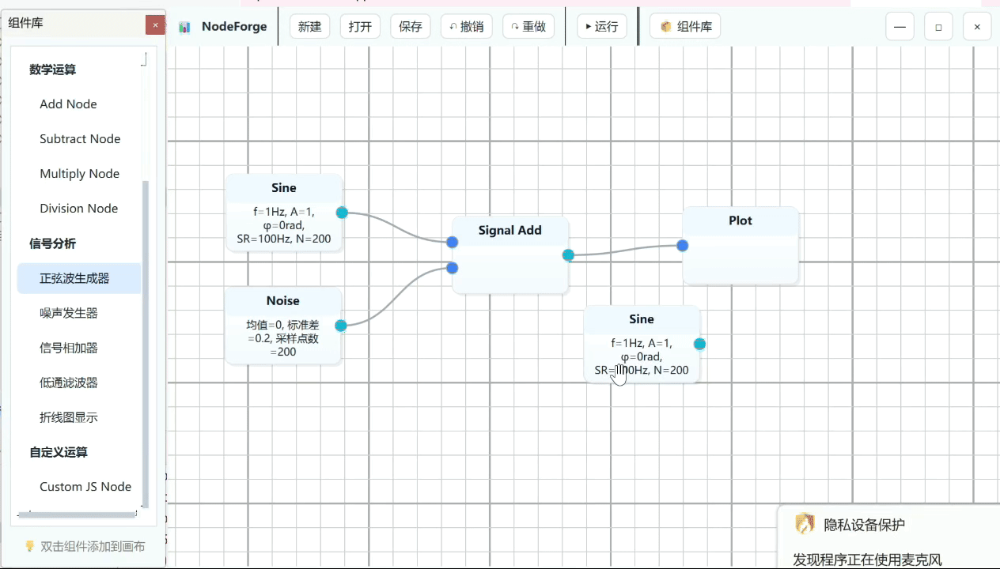
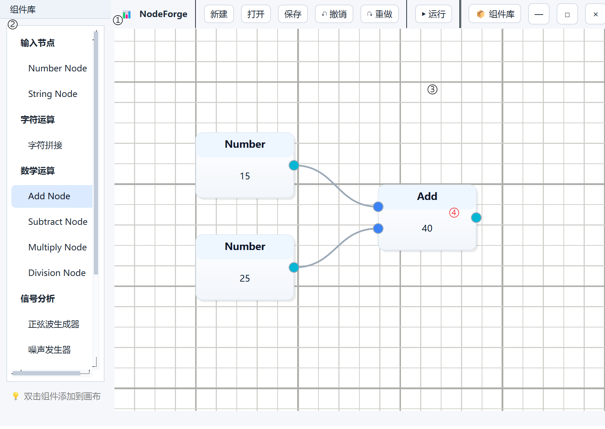
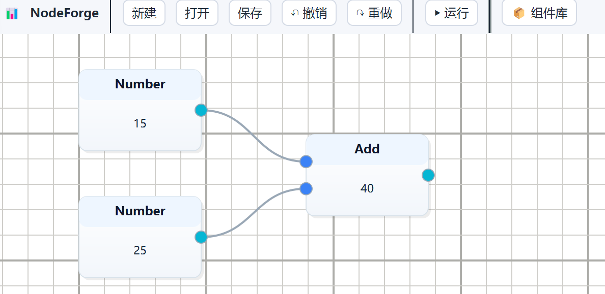
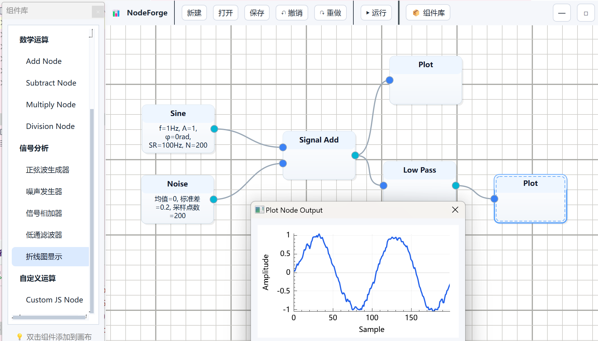
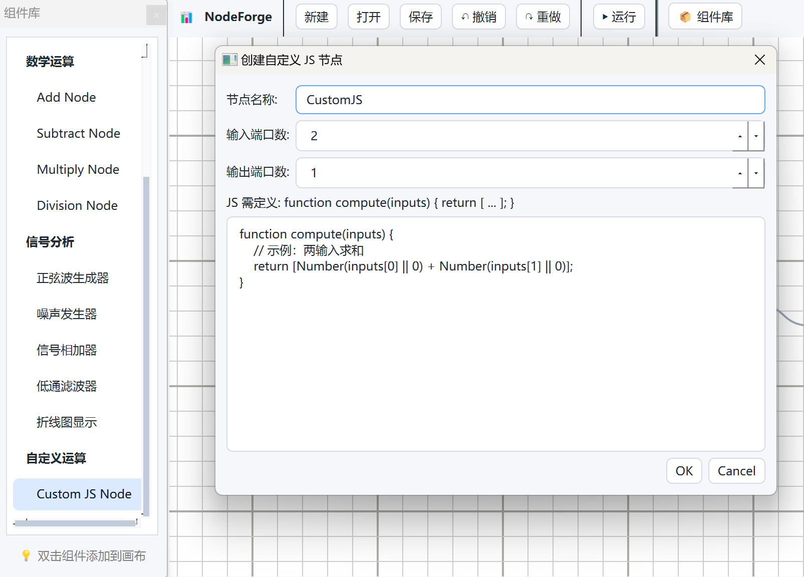

# NodeForge 🛠️

<p align="center">
  <strong>基于 Qt 6 与 C++20 的现代化高性能可视化节点流式计算引擎</strong>
</p>

<p align="center">
  
  
  
  
  
</p>

---

## 📌 项目简介

**NodeForge** 是一个轻量级、跨平台的可视化节点编辑器与数据流执行框架。用户可以通过在无限画布上拖拽节点、连接端口来直观构建逻辑链路，并通过内置的拓扑执行引擎进行高效计算。

无论是基础算术、信号发生与低通滤波仿真，还是通过 JavaScript 编写自定义算法，NodeForge 都能提供流畅易用的图形化交互体验。

<!-- ================================================================= -->
<!-- 【图片占位 1：全景动态演示图】                                      -->
<!-- 建议尺寸：建议录制 5~8 秒动图，压缩为 GIF 或 WebP                   -->
<!-- 展示内容：从左侧添加节点 -> 连线 -> 点击运行 -> 得到结果的完整动态过程 -->
<!-- ================================================================= -->
<p align="center">
  
</p>

---

## ✨ 核心特性

- 🎨 **现代化无边框交互**：自定义深色质感标题栏，支持丝滑的无限画布平移、滚轮缩放与网格背景。
- ⚡ **拓扑执行引擎**：内置 DAG（有向无环图）拓扑排序算法，毫秒级依赖解析与从左至右执行。
- 📊 **信号处理与图表绘制**：内置正弦波发生器、噪声注入、低通滤波器，并无缝集成 **QCustomPlot** 进行曲线可视化。
- 🚀 **动态脚本扩展 (JavaScript)**：内置 `QJSEngine`，无需重新编译 C++ 代码，在图形界面中即可用 JS 编写并执行自定义节点。
- ↩️ **完善的撤销/重做系统**：基于 Qt Undo Framework 实现节点移动、连线、删除的全量历史追踪 (`Ctrl+Z` / `Ctrl+Y`)。
- 💾 **工程持久化**：支持完整的工程保存与恢复，图结构与节点内部状态均以标准的 `.json` 格式存储。

---

## 🖥️ 界面布局总览

在使用 NodeForge 之前，你可以先熟悉以下核心功能分区：

<!-- ================================================================= -->
<!-- 【图片占位 2：界面功能分区图】                                      -->
<!-- 展示内容：主界面全屏截图，打上 ① ② ③ ④ 标号指引                   -->
<!-- ================================================================= -->
<p align="center">
  
</p>

- **① 顶部控制栏**：包含工程管理（新建/打开/保存）、历史操作（撤销/重做）以及核心的 `▶ 运行 (Run)` 触发按钮。
- **② 左侧组件库 (Library)**：收纳所有内置及自定义节点，双击即可直接生成到画布中央。
- **③ 主编辑画布 (Graph Canvas)**：支持无限平移与缩放的网格工作区，在此处进行节点的摆放与连线。
- **④ 节点属性与输出指示**：节点会直观展示当前连线状态与最新一次执行的计算结果。

---

## 🚀 快速上手：3分钟创建你的第一个流

以创建一个简单的 **“两个数值相加”** 工作流为例：

<!-- ================================================================= -->
<!-- 【图片占位 3：快速上手实操图】                                      -->
<!-- 展示内容：Number 节点与 Add 节点相连并计算出结果的清晰截图          -->
<!-- ================================================================= -->
<p align="center">
  
</p>

1. **添加节点**：在左侧组件库中双击 `Number` 节点两次，再双击 `Add` 节点一次。
2. **配置参数**：双击两个 `Number` 节点的标题栏，在弹出框中分别输入数值（例如 `15` 和 `25`）。
3. **建立连接**：按住 `Number` 节点右侧的**输出端口**，拖出连线并吸附至 `Add` 节点左侧对应的**输入端口**。
4. **一键计算**：点击顶部工具栏的 **`▶ 运行`** 按钮，`Add` 节点的将实时显示最终结果 `40`。

---

## 💡 进阶实战展示

| 📈 信号处理与实时波形展示 (DSP Flow) | 💻 动态 JavaScript 节点扩展 |
| :---: | :---: |
| <!-- 【图片占位 4-A：信号滤波图】展示 SineWave + Noise -> Filter -> Plot 效果 -->  | <!-- 【图片占位 4-B：自定义JS弹窗】展示编写 JS 脚本的对话框截图 -->  |
| 正弦波注入高频噪声，经过低通滤波后使用 **PlotNode** 绘制对比波形 | 自由定义输入/输出端口数量，用 JS 脚本动态编写运算逻辑并即时执行 |

---

## ⌨️ 键鼠交互与快捷键速查

| 交互操作 | 快捷键 / 鼠标动作 | 作用说明 |
| :--- | :--- | :--- |
| **画布平移** |  左键拖拽 | 在无限画布中自由移动视重视野 |
| **画布缩放** | 鼠标滚轮滑动 | 以鼠标指针所在位置为中心缩放 |
| **端口连线** | 左键从输出端口（右）拖拽至输入端口（左） | 支持端口自动吸附判定 |
| **删除元素** | 选中节点或连线后按 `Delete` | 支持点选或框选后批量删除 |
| **撤销 / 重做** | `Ctrl + Z` / `Ctrl + Y` | 回退或重做先前的编辑动作 |
| **执行流图** | 点击顶部工具栏 `▶ 运行`  | 触发全局拓扑计算并刷新数据显示 |
| **修改节点数据** | 双击节点标题栏 | 唤起参数配置弹窗 |

---

## 📦 内置节点库列表

| 分类 | 节点名称 | 功能说明 |
| :--- | :--- | :--- |
| **基础输入** | `Number` | 提供数值标量输出（支持浮点与整数） |
| | `String` | 提供纯文本字符串输出 |
| **数学运算** | `Add` / `Sub` | 双输入加法与减法运算 |
| | `Mul` / `Div` | 双输入乘法与除法运算（内置除零安全防护） |
| **文本处理** | `StringAdd` | 文本拼接与字符串合并操作 |
| **信号发生与DSP**| `SineWave` | 生成指定振幅、频率与采样率的正弦波序列 |
| | `Noise` | 生成高斯/均匀分布随机噪声序列 |
| | `SignalAdd` | 多路信号线性叠加 |
| | `LowPassFilter`| 一阶/二阶低通数字滤波，平滑高频杂波 |
| **可视化** | `PlotNode` | 集成 QCustomPlot，弹窗交互式绘制数据曲线 |
| **高级脚本** | `CustomJsNode`| 自定义输入端口与 JS 算法，由 `QJSEngine` 动态解析 |

---

## 🛠️ 构建与运行指南

### 环境依赖
- **C++ 编译器**: 支持 C++20（推荐 MSVC 2022 / GCC 11+ / Clang 13+）
- **Qt 框架**: Qt 6.4+（需勾选 `Qt Widgets`、`Qt Qml / Qt QJSEngine` 模块）
- **构建工具**: CMake 3.20+

### 编译步骤

#### 方式一：使用 IDE（推荐）
直接在 **CLion**、**Qt Creator** 或 **Visual Studio** 中打开项目根目录的 `CMakeLists.txt`，IDE 将自动完成配置，点击 **Build** 与 **Run** 即可。

#### 方式二：命令行编译
```bash
# 1. 克隆代码库
git clone https://github.com/your-username/NodeForge.git
cd NodeForge

# 2. 创建构建目录
mkdir build
cd build

# 3. 生成构建文件 (请将 <Qt_Path> 替换为您实际的 Qt 安装目录)
cmake .. -DCMAKE_PREFIX_PATH="<Qt_Path>/6.x.x/msvc2022_64"

# 4. 执行编译
cmake --build . --config Release

# 5. 运行程序
./Release/NodeForge.exe
```

---

## ❓ 常见问题 (FAQ)

<details>
<summary><strong>Q: 为什么连线无法成功连接？</strong></summary>
NodeForge 严格遵循单向数据流规则：连线必须从节点的<strong>输出端口（通常在右侧）</strong>拉向另一节点的<strong>输入端口（通常在左侧）</strong>。反向拖拽或同类型端口之间不允许连接。
</details>

<details>
<summary><strong>Q: 节点图中如果出现环路（循环连接）会怎样？</strong></summary>
执行引擎在每次运行前都会进行有向无环图（DAG）的环路检测。如果检测到循环依赖，系统将中断执行并在状态栏发出警告，防止程序陷入死循环。
</details>

<details>
<summary><strong>Q: 自定义 JS 节点的脚本编写有什么规则？</strong></summary>
在脚本中，输入端口的值将按顺序映射为 <code>in0</code>, <code>in1</code> 等变量。你的脚本只需在末尾通过 <code>return</code> 语句返回计算结果即可，例如：
<pre><code>// 两个输入端口的加权和
return in0 * 0.7 + in1 * 0.3;
</code></pre>
</details>

